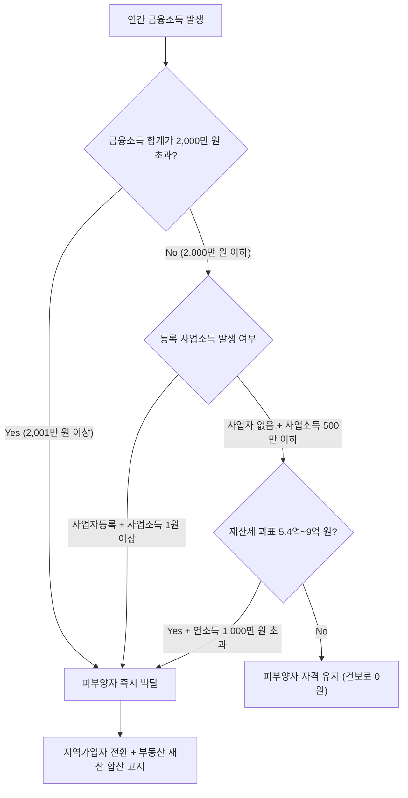

많은 은퇴자나 자산가들이 국세청 소득세 고지서보다 국민건강보험공단 고지서를 받고 더 큰 충격에 빠집니다. 

소득세는 2,000만 원을 초과한 '초과분'에 대해서만 누진세율이 적용되지만, **건강보험료는 단 1원만 넘겨도 금융소득 '전액'에 대해 보험료가 매겨지며 가족의 피부양자 자격마저 완전히 박탈당하기 때문**입니다. 이를 세무·복지 학계에서는 **'건보료 2,000만 원 절벽 효과(Cliff Edge Effect)'**라고 부릅니다.

---

## 1. 2,000만 원의 절벽 효과: 초과분이 아닌 '전액' 부과

국민건강보험법 시행령에 따르면, 금융소득(이자+배당)은 연간 합계 2,000만 원 이하일 경우 건강보험료 산정 소득에서 **완전히 0원(제외)**으로 처리됩니다.

그러나 2,000만 원을 초과하는 순간 다음과 같은 극단적인 역진 현상이 발생합니다:

| 연간 금융소득 | 국세청 소득세 | 건보공단 반영 소득 | 월 추가 건강보험료(요양 포함 약 8.0%) |
|---|---|---|---|
| **1,999만 원** | 15.4% 원천징수 종결 | **0원** (미반영) | **0원** (피부양자 유지) |
| **2,001만 원** | 초과분(1만 원)만 합산 | **2,001만 원 전액 반영!** | **월 약 133,500원 (연 160만 원 추가!)** |

단 2만 원의 이자를 더 받았다는 이유로, 2,000만 원 전체에 대해 약 8%에 달하는 건강보험료 및 노인장기요양보험료가 일시에 고지되는 것입니다.

---

## 2. 직장가입자의 소득월액보험료 vs 지역가입자 피부양자 박탈

현재 건강보험 가입 자격 형태에 따라 충격의 양상이 다릅니다.

### 1) 직장인 (근로소득이 있는 직장가입자)
- **보수 외 소득월액보험료**: 월급 외의 종합소득(금융+사업+기타)이 연간 2,000만 원을 초과하는 경우, **2,000만 원을 초과한 금액에 대해서만** 본인이 100% 부담하는 소득월액보험료(건보 7.09% + 장기요양 12.95%, 합산 약 8.008%)가 부과됩니다.
- 회사에는 통보되지 않으며 근로자 개인에게 별도로 고지됩니다.

### 2) 은퇴자 및 주부 (자녀·배우자의 직장 건보 피부양자)
- **가장 치명적인 피해 계층**입니다.
- 연간 금융소득이 2,000만 원을 초과하면 **피부양자 자격이 그 즉시 상실**됩니다.
- 즉시 **지역가입자로 강제 전환**되며, 이때 금융소득뿐만 아니라 **본인이 보유한 아파트, 토지, 건물(재산세 과세표준)**까지 모두 합산되어 지역 건보료 점수가 매겨집니다.
- 서울 아파트 한 채를 소유한 은퇴자가 금융소득 2,001만 원을 기록하면, 매월 40~60만 원(연 500~700만 원)에 달하는 지역 건강보험료 고지서를 받게 됩니다.

---

## 3. 피부양자 자격 박탈 기준 요약표

국민건강보험 피부양자 인정기준(보건복지부 고시)은 소득과 재산 두 축으로 엄격히 심사됩니다:

1. **소득 기준**:
   - 사업자등록이 있는 경우: 사업소득금액이 **단 1원이라도** 발생하면 즉시 탈락
   - 사업자등록이 없는 경우(프리랜서 등): 사업소득금액 연 500만 원 초과 시 탈락
   - 모든 종합소득(금융, 근로, 연금, 기타) 합계가 **연 2,000만 원 초과 시 즉시 탈락**
2. **재산 기준**:
   - 재산세 과세표준이 **9억 원 초과** 시 소득과 무관하게 탈락
   - 재산세 과세표준이 **5.4억 원 초과 ~ 9억 원 이하**이면서 연간 소득이 **1,000만 원 초과** 시 탈락

---

## 4. 건보공단의 데이터 수집 주기와 고지 타이밍

- 국세청은 매년 5월 종합소득세 신고 결과를 취합하여 **매년 10월 말경** 국민건강보험공단에 전산 통보합니다.
- 건보공단은 이를 바탕으로 **매년 11월분 보험료(11월 20일경 발송되는 12월 10일 납기 고지서)**부터 새로운 소득을 적용합니다.
- 즉, 2025년에 2,000만 원을 초과한 금융소득은 2026년 5월 신고를 거쳐 **2026년 11월부터 2027년 10월까지 1년간** 매달 부과됩니다.

---

## 5. 2장 핵심 요약 체크리스트

1. 금융소득 2,000만 원 초과 시 국세청 소득세는 초과분만 과세되지만, 건강보험료는 **2,000만 원 전액에 대해 약 8%가 부과**된다.
2. 직장인은 보수 외 소득월액보험료만 추가 납부하면 되지만, 피부양자는 자격이 박탈되어 **보유 부동산 전체에 대해 지역 건보료 폭탄**을 맞는다.
3. 따라서 자산 포트폴리오 관리의 최우선 목표는 2,000만 원 이하로 금융소득을 통제하는 것입니다.
4. **3장: 비과세·분리과세 금융상품(ISA, 비과세종합저축, 브라질국채)**을 통해 합법적으로 금융소득 통보를 원천 차단하는 포트폴리오를 알아봅니다.
