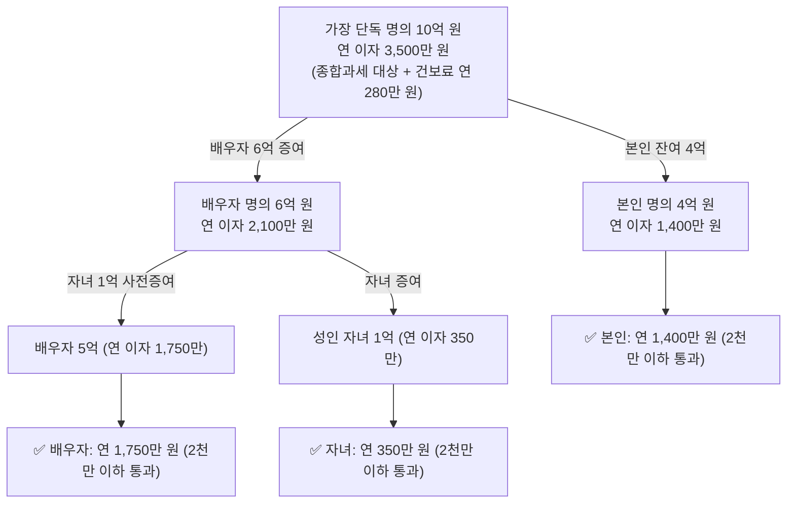

시리즈의 마지막 장에서는 매년 5월 종합소득세 신고 기간에 당황하지 않고 정확하게 대응하는 실무 요령과, 연중 미리 실행해야 하는 **'사전 분산 및 방어 테크닉'**을 총정리합니다.

금융소득은 12월 31일이 지나고 나면 사후에 되돌릴 수 없으므로, 반드시 연중에 시기와 명의를 관리해야 합니다.

---

## 1. 5월 국세청 홈택스 금융소득 통합조회 실무

금융소득종합과세 대상자가 되면 은행과 증권사를 일일이 방문하여 원천징수영수증을 뗄 필요가 없습니다. 국세청 홈택스 전산망에 국내 모든 금융기관의 지급명세서가 통합 집계되기 때문입니다.

### 홈택스 확인 절차
1. **접속**: 국세청 홈택스(hometax.go.kr) 로그인 (매년 5월 1일 이후)
2. **조회 메뉴**: `세금신고` → `종합소득세 신고` → `신고도움 서비스` 또는 `금융소득 명세서 조회`
3. **금융기관별 내역 확인**:
   - 금융기관명, 계좌번호, 이자·배당 소득구분, 원천징수세액, Gross-up 대상 여부 확인
4. **주의점**:
   - 해외 증권사(미국 로빈후드, 위불 등)에서 직접 수취한 해외주식 배당금은 국내 금융회사 지급명세서에 자동으로 안 뜰 수 있으므로, 본인이 직접 외화환산하여 합산 신고해야 가산세를 피할 수 있습니다.

---

## 2. 배당시기와 예금 만기 분산 전략

금융소득종합과세는 **'귀속 연도(매년 1월 1일~12월 31일)'** 기준으로 판정합니다. 따라서 동일한 수익이라도 수령 시기를 쪼개면 2,000만 원 문턱을 쉽게 방어할 수 있습니다.

### 1) 예금 만기 월 분산
- 3년 만기 정기예금에 2억 원을 한 번에 가입하면, 3년 차 만기일에 3년 치 이자(약 2,000만 원 이상)가 일시에 지급되어 그해 즉시 종합과세 대상자가 됩니다.
- **해결책**: 매년 만기가 돌아오도록 1년, 2년, 3년 단위로 가입 시기를 분산하거나, 이자를 매월 수령하는 **'월지급식 정기예금'**을 활용하여 연도별 이자 발생액을 균등하게 분배합니다.

### 2) 상장사 분기배당 및 결산배당 일정 체크
- 한국 상장기업들도 점차 분기배당(3월, 6월, 9월, 12월)을 확대하고 있습니다.
- 연말에 배당락을 맞아 이듬해 4월에 거액의 결산배당이 집중되는 종목보다는, 연중 고르게 배당을 분산 지급하는 종목이나 ETF를 선택하는 것이 유리합니다.

---

## 3. 가족 간 사전 증여를 통한 '인별 2,000만 원' 복수 활용

대한민국 소득세와 건강보험료는 **'개인별(인별) 과세'**가 원칙입니다. 한 사람 명의로 10억 원의 금융자산을 가지고 있으면 금융소득이 3,500만 원이 되어 세금과 건보료를 모두 두들겨 맞지만, 부부와 자녀에게 합법적으로 나누어 두면 가족 전체의 세금이 0원이 됩니다.

### 증여재산공제 한도 (10년 누적)
- **배우자**: **6억 원**까지 증여세 0원
- **직계비속 (성인 자녀)**: **5,000만 원**까지 증여세 0원 (미성년자 2,000만 원)
- **혼인·출산 특별공제**: 직계존속으로부터 혼인·출산 시 **1억 원 추가 공제 (기본 포함 총 1.5억 원)**

### 시뮬레이션: 금융자산 10억 원 분산

위와 같이 합법적인 사전 증여를 거치면, 가족 구성원 전원이 **연간 2,000만 원 미만의 금융소득 구간**에 안착하여 소득세 종합과세와 건강보험료 피부양자 박탈을 완벽하게 예방할 수 있습니다.

---

## 4. 세무 점검 및 체크리스트

1. [ ] 국세청 홈택스에서 전년도 금융소득 합계가 2,000만 원을 초과했는지 5월 초에 즉시 조회했는가?
2. [ ] 2,000만 원 초과 시 직장가입자 보수외소득월액보험료 또는 지역가입자 전환 예고를 인지하고 있는가?
3. [ ] 올해 만기가 도래하는 거액의 정기예금이나 채권의 이자 지급일이 특정 연도에 몰려있지 않은가?
4. [ ] 보유 중인 일반 주식 계좌의 배당주 및 국내 상장 해외ETF를 **중개형 ISA**로 이전했는가?
5. [ ] 배우자 6억 원 공제를 활용하여 금융계좌 명의를 적절히 분산해 두었는가?

---

## 아카데미 완강을 축하합니다!

금융소득종합과세는 부자들만의 문제가 아닙니다. 은퇴 후 예금 이자와 배당으로 생활비를 마련하는 평범한 중장년층에게도 건강보험료 폭탄이라는 현실적인 위협으로 다가옵니다.

1장에서 배운 **비교과세 원리**, 2장의 **건보료 2,000만 원 절벽 효과**, 3장의 **ISA·비과세 포트폴리오**, 4장의 **사전 분산 노하우**를 종합적으로 적용하여 여러분의 소중한 자산과 은퇴 현금흐름을 안전하게 지키시기 바랍니다.
